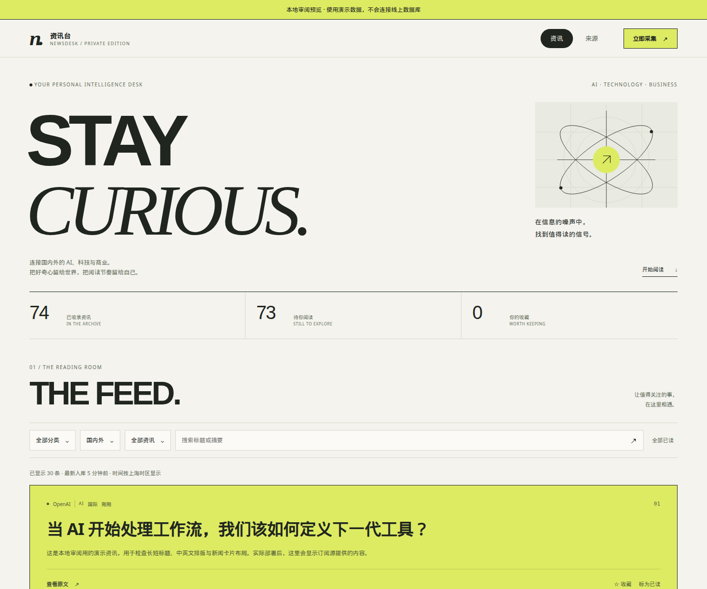
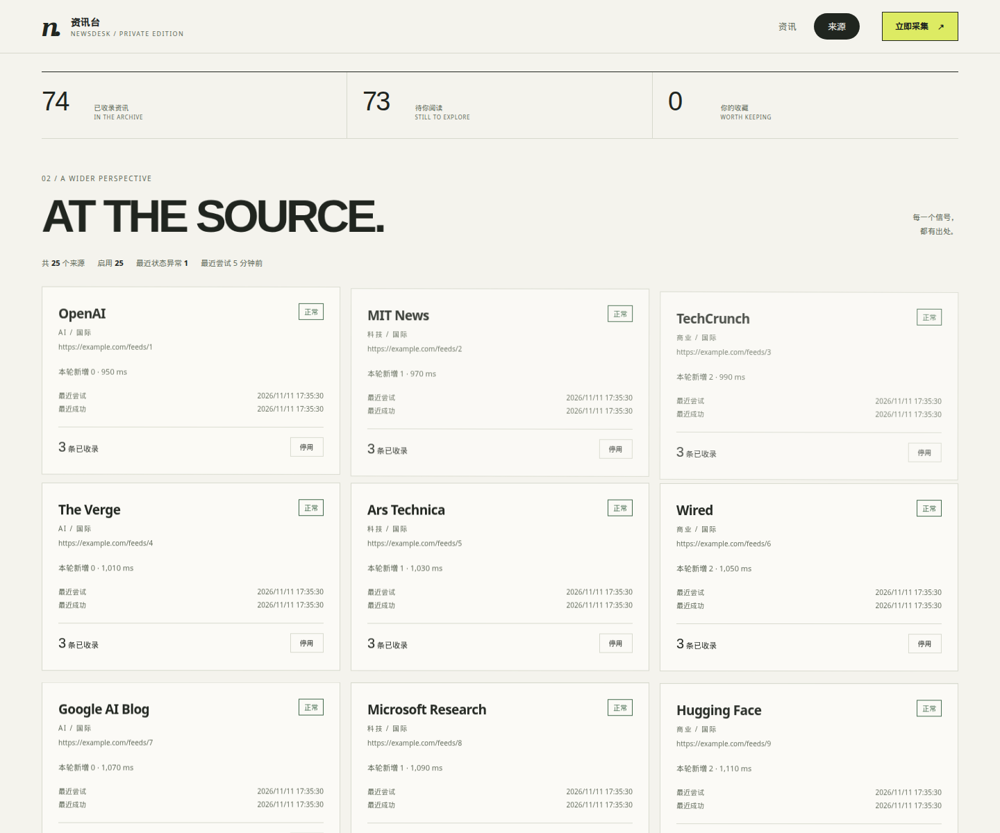

# 资讯台 · Newsdesk

自己的 AI、科技与商业阅读台。一个 Cloudflare Worker 同时提供阅读页面、JSON API 和定时采集；文章、已读和收藏保存在 D1。`TEAM_DOMAIN` 和 `ACCESS_AUD` 都留空时，页面只给 `ALLOWED_GITHUB_LOGINS` 里的 GitHub 账号打开。这两个变量都有值时，仍走 Cloudflare Access。

A personal reader for AI, technology, and business. One Cloudflare Worker serves the page, the JSON API, and the scheduled collector. Articles, read state, and stars are stored in D1. When `TEAM_DOMAIN` and `ACCESS_AUD` are both empty, the page is limited to GitHub logins listed in `ALLOWED_GITHUB_LOGINS`. When both variables are set, the Worker still checks Cloudflare Access.

[项目介绍](https://jjh-python667.github.io/projects/newsdesk.html) · [作者的作品集](https://jjh-python667.github.io/) · [私人实例](https://newsdesk.gongjiangcai.workers.dev/)

私人实例没有公开注册。当前代码在未配置 Access 时，未登录打开页面会看到中文登录页，按钮是「用 GitHub 登录」；`/api/` 返回 `401` 和 `{"error":"unauthenticated"}`。`TEAM_DOMAIN` 和 `ACCESS_AUD` 都设置、但 Access JWT 校验失败时，`deny()` 仍返回 HTTP 403，正文以「403 Forbidden — 仅限通过 Cloudflare Access 登录访问」开头。

2026-11-11 18:2x（Asia/Shanghai）测过当时的入口 `newsdesk.gongjiang667.workers.dev`：未登录请求得到 302，并转到 Access 登录页。那是旧账号上 Access 的测量，不是这份 GitHub 登录代码的行为。新实例地址是 `https://newsdesk.gongjiangcai.workers.dev`。这份代码部署之前，线上仍是 Worker 自己的 Access 校验失败后的 403。

The private instance has no public signup. In the current code, an unauthenticated page shows a Chinese login page with the button 「用 GitHub 登录」 when Access is not configured, and `/api/` returns `401` with `{"error":"unauthenticated"}`. When `TEAM_DOMAIN` and `ACCESS_AUD` are both set and the Access JWT check fails, `deny()` still returns HTTP 403. The body starts with `403 Forbidden — 仅限通过 Cloudflare Access 登录访问`.

On 2026-11-11 at 18:2x Asia/Shanghai, `newsdesk.gongjiang667.workers.dev` answered an unauthenticated request with a 302 to the Access login page. That measurement is the old account behind Access. It is not the GitHub login in this code. The new instance is `https://newsdesk.gongjiangcai.workers.dev`. Until this code is deployed, the live Worker still returns its own Access 403.

## 它实际做什么

下面只写当前代码里有的行为。

### 阅读页

`src/ui.html` 是页面源文件，`src/ui.js` 是 Worker 导入的生成模块。页面可以：

- 按分类（AI、科技、商业）、地区（国内、国际）、未读或收藏筛选，并搜索标题和摘要。
- 每次向接口要一页，默认 30 条；还有下一页时显示「再读一些」。
- 收藏、标已读或未读。点「全部已读」时，浏览器先弹出确认，确认后才请求接口。
- 用文章自己的 `http` 或 `https` 地址打开原文，`target="_blank"`，并带 `rel="noopener noreferrer"`。点击不会被脚本取消；已读状态另外用 `POST` 异步保存。
- 在「来源」里查看每条来源的状态、诊断，并启用或停用。页面不能新增、删除或修改来源地址。
- 用右上角「立即采集」触发全部已启用来源的采集。页面没有单条来源的采集按钮。
- 若数据库里已有 `translated_title` 或 `summary_zh`，卡片优先显示它们。本仓库没有任何代码写入这两个字段，也没有调用模型。
- 适配手机宽度、深色模式（`prefers-color-scheme`）和减少动态效果。开场动画每个标签页会话播放一次。脚本不可用时，页面仍保留说明文字。

动效使用浏览器的 Web Animations API 和 IntersectionObserver。没有生产 npm 依赖，没有外链字体、图片、视频或 WebGL。插画是页面内的 SVG。

### API

除 `/internal/collect`、`/auth/github/start`、`/auth/github/callback` 和 `/auth/logout` 外，这些路由都要先登录。Access 的两个变量都设置时走 Access；否则走 GitHub 会话。未登录时，页面返回登录页，`/api/` 返回 `401`。`handleApi` 里除 `GET` 和 `HEAD` 以外的请求必须带 `x-newsdesk: 1`，否则返回 `403` 和 `{"error":"csrf check failed"}`。定时任务 `scheduled` 不经过这道登录。

| 方法 | 路径 | 作用 |
| --- | --- | --- |
| GET | `/`、`/index.html` | 已登录时返回阅读页；GitHub 模式下未登录返回登录页 |
| GET | `/auth/github/start` | 跳到 GitHub 授权。请求不带 scope |
| GET | `/auth/github/callback` | GitHub 回调。state 用过即删 |
| GET、POST | `/auth/logout` | 清掉浏览器里的会话 cookie，回到 `/` |
| GET | `/api/me` | Access 模式返回令牌里的邮箱；GitHub 模式返回 `{login}` |
| GET | `/api/articles` | 分页列表 |
| POST | `/api/articles/:id/read` | 设置已读，正文 `{"value":true}` 或 `false` |
| POST | `/api/articles/:id/star` | 设置收藏 |
| POST | `/api/articles/read-all` | 把未读全部标为已读 |
| GET | `/api/sources` | 来源和每条来源的文章数 |
| POST | `/api/sources/:id/enable` 或 `disable` | 启用或停用 |
| POST | `/api/sources/:id/collect` | 只采集这一条 |
| POST | `/api/collect` | 采集全部已启用的来源 |
| GET | `/api/stats` | `total`、`unread`、`starred`、`last_fetch` |
| GET | `/go/:id` | 302 到文章原地址，并把该篇标为已读 |
| POST | `/internal/collect?id=` | 服务绑定使用的单源采集 |

文章列表支持 `category`、`region`、`source`、`filter=unread|starred`、`q` 和 `page`。`size` 默认 30，最大 100。阅读页不传 `source` 和 `size`。搜索词先截到 100 个字符、最多 5 段；一段达到 3 个 Unicode 字符时走 FTS5 trigram，更短的走 `LIKE`。

`/go/:id` 是 Worker 上的跳转。阅读页不使用它，原文走文章自己的链接。

### 采集

`sources.sql` 有 25 条 `rss` 来源，类别是 `ai`、`tech` 或 `business`，地区是 `cn` 或 `intl`。`schema.sql` 也允许 `type = 'api'`，但这份种子没有使用它，Worker 里也没有另一套 API 解析器。

`feeds.txt` 是更早的一份草稿，程序不读取它。

采集器会：

- 把每个来源地址当作 RSS 2.0、RSS 1.0（`rdf:RDF`）或 Atom 读取，只认 `<item>` 和 `<entry>`。
- 每条来源每轮最多 30 篇，正文最多读 5 MiB。
- 单次请求超时 25 秒。超时、网络错误、HTTP 429 和 5xx 最多再试 2 次，所以一条来源最多 3 次。一条来源的总预算是 70 秒。
- 最多同时处理 5 条来源。配置了 `SELF` 和 `INTERNAL_KEY` 时，每条来源通过服务绑定分到单独的调用；否则在同一次调用里采集。
- 用浏览器样式的 User-Agent 请求来源，不是一个单独的 `newsdesk` 标识。
- 去掉一组跟踪参数、`www.`、哈希，并把链接规范成 `https`。数据库同时保存原始链接和这个规范链接。
- 用规范链接和规范化标题去重。规范化后短于 8 个字符的标题改为按链接去重，避免短标题被误并。同一规范化标题在不同来源之间也不会重复入库。
- 把没有时区、形如 `2026-11-09 08:00:00` 的时间，国内来源按 `+08:00`、其他来源按 UTC 解释。超过当前时间 1 小时的发布时间改记为采集时间。
- 去掉 HTML 后，摘要超过 280 个字符就截断并加上省略号。整段只是「查看原文」一类占位句时记为空。
- 如果返回的是 HTML，尤其像验证页，这条来源记为失败并留下状态码、耗时和片段。已有文章不删除。
- 模板 `wrangler.example.jsonc` 的 cron 是 `*/30 * * * *`。来源页也写着每 30 分钟。仓库不包含线上账户的 `wrangler.jsonc`，所以这里不能代替线上定时任务的验收。

### 登录

`TEAM_DOMAIN` 和 `ACCESS_AUD` 都是非空字符串时，走 Access。校验使用 RS256。它检查密钥 id、签名、`aud`、`iss`、过期时间（允许 30 秒偏差）和 `nbf`（允许提前 60 秒）。`ALLOWED_EMAILS` 有值时，邮箱必须精确命中逗号分隔名单，比较时忽略大小写。这个变量为空时，Worker 不再额外检查邮箱；Access 应用本身仍可以限制谁能登录。只设置其中一个变量时，不算启用 Access，改走 GitHub 登录。

两个变量都留空时，走 GitHub OAuth。授权地址不带 `scope`，只能读到公开资料。`/auth/github/start` 生成 PKCE（S256）和一次性 `state`：`state` 的 SHA-256 和 `code_verifier` 写入 D1 表 `oauth_states`，10 分钟后过期，回调时用 `DELETE ... RETURNING` 删掉，所以同一个 state 不能用第二次。浏览器同时拿到 `__Host-newsdesk_oauth`。回调要和这个 cookie 一致。

登录成功后设置 `__Host-newsdesk_session`。Cookie 是 `Path=/`、`HttpOnly`、`Secure`、`SameSite=Lax`，不带 `Domain`。值是 HMAC-SHA256 签名，密钥是 `SESSION_SECRET`，里面是 GitHub 用户名和 30 天后的过期时间。每次请求都会再对一下 `ALLOWED_GITHUB_LOGINS`。名单是逗号分隔，比较时忽略大小写，空格会被去掉。名单为空，或用户名不在里面，一律拒绝，不发会话 cookie。退出登录会让浏览器丢掉这张 cookie；在过期前拿着旧 cookie 仍能通过签名校验，把该用户名从名单里去掉，或换掉 `SESSION_SECRET`，才会在服务端拒绝它。

访问 GitHub 的 `fetch` 使用 `redirect: "manual"`。Workers 不接受 `"error"`。3xx 会停住，不会跟着 `Location` 走。

`/internal/collect` 不走 Access，也不走 GitHub 登录。它只接受 `POST`，并且 `x-internal-key` 必须与非空的 `INTERNAL_KEY` 一致。密钥缺失或为空时直接拒绝。密钥已设置时，比较方式和原来相同。`scheduled` 同样不检查登录。

## 它不做什么

- 不提供访客账号，也不在这个仓库里保存 Cloudflare 账户、D1 id、Access AUD、GitHub client secret 或会话密钥。
- 不调用翻译或摘要模型。相关字段只是预留。
- 不在页面上添加来源。新库使用 `schema.sql` 和 `sources.sql`。
- 不把 `feeds.txt` 当作线上订阅清单。
- 本地预览不连接 D1，也不下载真实 RSS。

## 截图

三张图都是 2026-11-11 从本仓库的本地预览截取的，地址是 `http://127.0.0.1:4173/`。顶部黄条写着「本地审阅预览 · 使用演示数据，不会连接线上数据库」。

数字 74、73 和 0 来自 `review/preview.cjs` 里的固定数据：74 篇演示文章，其中 1 篇预先标为已读，所以未读是 73，收藏是 0。文章地址是 `example.com`。这不是线上文章数量。

来源页的 25 个名字和 `example.com/feeds/` 地址也是预览脚本里的假数据，不是 `sources.sql`，也不是一次真实采集。摘要行里的「1 个异常」是脚本写死的验证页记录。

`review/` 里其余 `*-review.png` 是更早一次审阅留下的图片，保留作记录。






## 安装、运行和测试

需要 Node.js 20 或更新版本。不需要 `npm install`，项目没有生产依赖。

1. 安装 Node.js 后，打开终端，运行 `node --version`。成功时版本不低于 `v20.0.0`。`v20.19.5` 和 `v22.23.4` 都可以。
2. 克隆并进入目录：

```bash
git clone https://github.com/jjh-python667/newsdesk.git
cd newsdesk
```

3. 运行测试：

```bash
npm test
```

成功标志：命令退出码为 0。前面的检查会打印 `"action": "verified"`。最后的测试汇总里 `fail` 为 0。

4. 打开本地预览：

```bash
npm run preview
```

成功标志：终端打印 `Newsdesk local review: http://127.0.0.1:4173 — demo data only`。用浏览器打开这个地址，页面最上方有黄条「本地审阅预览」。结束时在该终端按 Ctrl+C，提示符回到命令行。

如果端口已被占用，终端会报错且进程退出。关掉另一个预览，或换端口：

```bash
PORT=4174 npm run preview
```

```powershell
$env:PORT=4174; npm run preview
```

然后打开终端里打印出来的那个地址。预览只监听 `127.0.0.1`。

本地预览里可以点的位置：

- 顶部「资讯」「来源」切换两页。
- 右上角「立即采集」不会访问外部网站，提示全文是预览脚本写死的「采集完成：24/25 个来源成功，新增 0 条」。
- 「THE FEED.」下面有三个下拉框和搜索框。「全部已读」会先问确认。
- 「来源」页每张卡片底部有「停用」或「启用」。

修改页面时，编辑 `src/ui.html`，然后运行：

```bash
npm run build
npm test
```

`npm run build` 重新生成 `src/ui.js`。`npm test` 会在两者不一致时失败。

## 目录

- `src/worker.js`：采集、解析、登录门和 API。
- `src/github-auth.js`：GitHub OAuth、PKCE、一次性 state 和签名会话。
- `migrations/0001_oauth_states.sql`：已有数据库补 `oauth_states`。新库执行 `schema.sql` 时已经包含这张表。
- `src/ui.html`、`src/ui.js`：页面源文件和生成模块。
- `scripts/build-ui.cjs`：生成 `src/ui.js`，并用 `--check` 核对。
- `schema.sql`：建表，含全文索引和来源诊断列。语句使用 `IF NOT EXISTS`，不删除已有数据。
- `sources.sql`：25 条来源种子。
- `feeds.txt`：未使用的旧草稿。
- `wrangler.example.jsonc`：部署模板。真实的 `wrangler.jsonc` 被 Git 忽略。
- `review/preview.cjs`：只含内存演示数据的本地预览。
- `review/REVIEW.md` 和两份 JSON：更早的本地审阅记录。
- `test/`：不访问网络和外站的 Node 测试。
- `HANDOFF.md`：自己的账户要怎样部署。
- `.github/workflows/check.yml`：只运行 `npm test`。

## 部署到自己的账户

按 [HANDOFF.md](HANDOFF.md) 做。把 `wrangler.example.jsonc` 复制成被忽略的 `wrangler.jsonc`，填自己的非密钥配置。`INTERNAL_KEY`、`GITHUB_CLIENT_SECRET` 和 `SESSION_SECRET` 用 Cloudflare Secret 设置，不要写进仓库。仓库里的 GitHub Action 只运行 `npm test`。这次改动先核对，再由你自己部署；仓库里的脚本不会对远程执行 wrangler。

新实例如果不用 Access，按下面做。按钮位置以 2026 年 GitHub 和 Cloudflare 的网页为准。

### 1. 在 GitHub 新建 OAuth App

1. 浏览器打开 [GitHub Developer Settings](https://github.com/settings/developers)。左侧点 **OAuth Apps**。
2. 右上角点 **New OAuth App**。如果已经有应用，点进那个应用，核对回调地址，不要再建一个。
3. 填写这三项，其他权限不用勾：
   - Application name：`newsdesk`
   - Homepage URL：`https://newsdesk.gongjiangcai.workers.dev`
   - Authorization callback URL：`https://newsdesk.gongjiangcai.workers.dev/auth/github/callback`
4. 点 **Register application**。成功标志：页面上出现 **Client ID**。先复制它。
5. 点 **Generate a new client secret**。成功标志：出现一串只显示一次的 secret。立刻复制。离开页面后 GitHub 不会再显示完整 secret。

程序请求授权时不带 scope，只能读公开资料。

### 2. 在 Cloudflare 写入变量和 Secret

打开 [Cloudflare dashboard](https://dash.cloudflare.com/) → **Workers & Pages** → **newsdesk** → **Settings** → **Variables and Secrets**。

普通变量（类型选明文，不要选 Secret）：

| 名称 | 填写 |
| --- | --- |
| `GITHUB_CLIENT_ID` | 上一步的 Client ID |
| `ALLOWED_GITHUB_LOGINS` | 允许登录的 GitHub 用户名。这个仓库的所有者是 `jjh-python667`。只用这个账号时，填 `jjh-python667`。多个用户名用英文逗号分隔。 |

Secret（类型选 **Secret**。保存后列表里只看得到名字，看不到值）：

| 名称 | 填写 |
| --- | --- |
| `GITHUB_CLIENT_SECRET` | 上一步生成的 client secret |
| `SESSION_SECRET` | 至少 16 个字符的随机串。在自己的电脑打开终端，运行 `openssl rand -base64 32`，把打印出来的整行贴进去。不要把这行发到聊天里，也不要写进仓库。 |

确认 **TEAM_DOMAIN** 和 **ACCESS_AUD** 没有值。两个都有值时，Worker 仍走 Access，不会出现 GitHub 登录页。新账号不用 Access，就把这两个删掉或留空。`ALLOWED_EMAILS` 只在 Access 模式下有用。

点保存。成功标志：变量列表里能看到 `GITHUB_CLIENT_ID` 和 `ALLOWED_GITHUB_LOGINS` 的明文，两个 Secret 只显示名字。

### 3. 给已有的 D1 加上登录状态表

新库如果整份执行 `schema.sql`，里面已经有 `oauth_states`。已有的库不要为了这张表重跑整份 schema。打开 **Storage & databases** → **D1 SQL** → 选资讯台用的那个库 → **Console**，把 `migrations/0001_oauth_states.sql` 里的语句贴进去执行。

成功标志：执行结果没有报错，表列表里出现 `oauth_states`。这张表只存 10 分钟内的登录 state，不存文章，也不存会话。会话在签名 cookie 里。

### 4. 部署之后怎样算成功

部署由你核对之后自己做。用浏览器的无痕窗口打开 `https://newsdesk.gongjiangcai.workers.dev/`。成功标志：页面是中文，有按钮「用 GitHub 登录」。点下去会到 GitHub。用名单里的账号授权后回到资讯台，能看到文章列表。用名单以外的账号授权，页面显示不能登录，进不了 `/api/`。

## 仓库里的测量记录

- `npm run check` 报告 `src/ui.html` 为 44,441 字节，gzip 后 14,461 字节。这是文件体积，不是一次线上传输测量。
- `review/functional-results.json` 有 24 条记录，每条都是 `"passed": true`。那次用的是本地模拟接口。
- `review/performance-results.json` 是一次本地样本，不是生产环境成绩。数值以该文件为准。
- 作者在 2026-11-09 的部署记录里写过：25 个来源中 24 个成功，36氪返回人机验证页，旧文章保留。

## 内容归属

来源站点的文章、标题和图片仍归各自权利人所有。这个仓库不附带抓下来的文章库。

## 许可

本仓库代码采用 [MIT](LICENSE)。

## English reference

### What it does

The Worker is the page, the API, and the collector. D1 stores sources and articles. The checked-in seed, `sources.sql`, inserts 25 RSS sources. `feeds.txt` is an unused draft.

The page filters by category, region, unread, and starred, searches, pages 30 items at a time, stars and marks read, and opens the article's own URL in a new tab. Marking read is a separate request and does not cancel that click. The sources tab can enable or disable a source and shows the last error, status, timing, and a short body snippet. It cannot create or edit a feed URL. The only collect button runs every enabled source. `POST /api/sources/:id/collect` exists for one source, but the page does not call it.

`translated_title` and `summary_zh` are selected and preferred when present. No code in this repo fills them.

The collector parses RSS 2.0, RSS 1.0, and Atom, keeps at most 30 items and 5 MiB per source, times out after 25 seconds, retries transient failures twice, and limits a source to 70 seconds. At most five sources run at once. With `SELF` and `INTERNAL_KEY`, each source is a separate service-binding call. Canonical URLs drop a fixed set of tracking parameters, a leading `www.`, and the hash; the stored article still keeps the original URL. Deduping uses the canonical URL and a normalized title. Titles that normalize to fewer than 8 characters dedupe by URL instead. An HTML challenge fails that source and leaves existing articles in place.

The example cron is every 30 minutes. The live account config is not in this repo.

Access verification still runs when both `TEAM_DOMAIN` and `ACCESS_AUD` are non-empty. It is RS256 and checks audience, issuer, expiry with 30 seconds of skew, and `nbf` with 60 seconds of skew. `ALLOWED_EMAILS` is an optional exact list. An empty list does not add another email check inside the Worker. Setting only one of the two Access variables does not enable Access.

Otherwise the Worker uses GitHub OAuth with an empty scope, PKCE S256, and a one-time `state` row in `oauth_states`. The session cookie is `__Host-newsdesk_session`: `Path=/`, `HttpOnly`, `Secure`, `SameSite=Lax`, no `Domain`. Its value is an HMAC-SHA256 payload signed with `SESSION_SECRET`, valid for 30 days, and checked against `ALLOWED_GITHUB_LOGINS` on every request. Calls to GitHub use `fetch` with `redirect: "manual"`. `/internal/collect` and `scheduled` skip both login methods. The collector still requires a non-empty `INTERNAL_KEY`.

### Run and test

Install Node.js 20 or newer. Do not run `npm install`.

```bash
git clone https://github.com/jjh-python667/newsdesk.git
cd newsdesk
npm test
npm run preview
```

`npm test` exits 0 when the UI module matches, the syntax checks pass, and every test passes. The preview prints `Newsdesk local review: http://127.0.0.1:4173 — demo data only`. The yellow banner says the data is local and fixed. Ctrl+C stops it. If port 4173 is taken, the process exits with an error. Use another port and open the URL it prints:

```bash
PORT=4174 npm run preview
```

```powershell
$env:PORT=4174; npm run preview
```

The preview collect button does not fetch feeds, and its toast is the fixed demo text 「采集完成：24/25 个来源成功，新增 0 条」.

After editing `src/ui.html`, run `npm run build` and then `npm test`.

### Deploy

Follow `HANDOFF.md` on your own Cloudflare account. Keep `wrangler.jsonc`, `.dev.vars`, and secrets out of Git. The included workflow runs `npm test` only.

For the instance at `https://newsdesk.gongjiangcai.workers.dev`, create a GitHub OAuth App whose callback is `https://newsdesk.gongjiangcai.workers.dev/auth/github/callback`. Set plain variables `GITHUB_CLIENT_ID` and `ALLOWED_GITHUB_LOGINS`. Set secrets `GITHUB_CLIENT_SECRET` and `SESSION_SECRET` (at least 16 characters). Leave `TEAM_DOMAIN` and `ACCESS_AUD` empty to use GitHub login. Apply `migrations/0001_oauth_states.sql` to an existing D1 database. Deploy only after reviewing the change. This repository does not run wrangler against the remote account.

The screenshots in this file are the local preview described above. `npm run check` reports `src/ui.html` as 44,441 bytes, 14,461 bytes gzipped. `review/functional-results.json` records 24 local checks, all marked passed.

### Attribution

Source articles, titles, and images stay with their publishers. This repository does not include a fetched article database.

### License

The code in this repository is released under the [MIT License](LICENSE).
