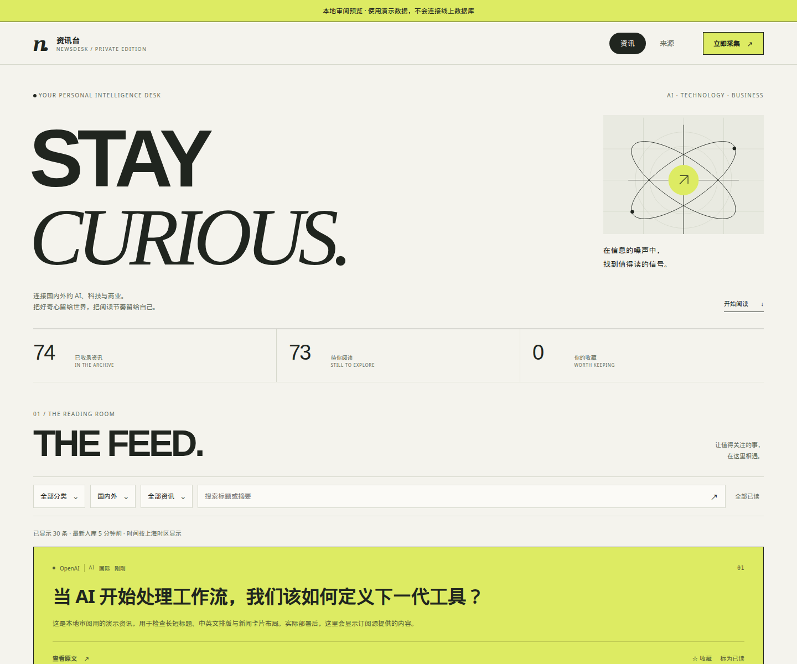
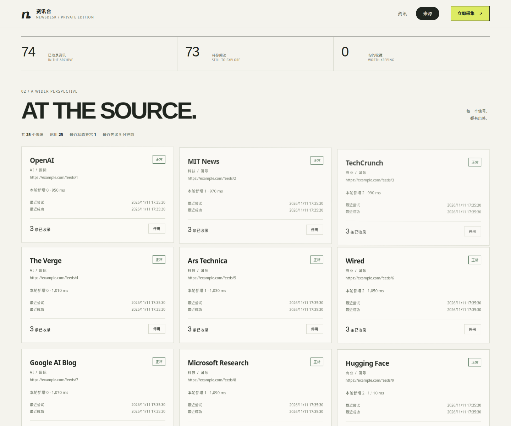

# 资讯台 · Newsdesk

自己的 AI、科技与商业阅读台。一个 Cloudflare Worker 同时提供阅读页面、JSON API 和定时采集；文章、已读和收藏保存在 D1。页面只给通过 Cloudflare Access 的人打开。

A personal reader for AI, technology, and business. One Cloudflare Worker serves the page, the JSON API, and the scheduled collector. Articles, read state, and stars are stored in D1. The page is limited to people who pass Cloudflare Access.

[项目介绍](https://jjh-python667.github.io/projects/newsdesk.html) · [作者的作品集](https://jjh-python667.github.io/) · [私人实例](https://newsdesk.gongjiang667.workers.dev/)

私人实例没有公开注册。2026-11-11 在未携带登录凭据时请求该地址，返回 HTTP 403。仓库里的 Worker 会拒绝没有有效 Access 令牌的访问。

The private instance has no public signup. On 2026-11-11 a request without credentials returned HTTP 403. The Worker in this repo rejects requests that do not carry a valid Access token.

## 它实际做什么

下面只写当前代码里有的行为。

### 阅读页

`src/ui.html` 是页面源文件，`src/ui.js` 是 Worker 导入的生成模块。页面可以：

- 按分类（AI、科技、商业）、地区（国内、国际）、未读或收藏筛选，并搜索标题和摘要。
- 每次向接口要一页，默认 30 条；还有下一页时显示「再读一些」。
- 收藏、标已读或未读。点「全部已读」时，浏览器先弹出确认，确认后才请求接口。
- 用文章自己的 `http` 或 `https` 地址打开原文，`target="_blank"`，并带 `rel="noopener noreferrer"`。点击不会被脚本取消；已读状态另外用 `POST` 异步保存。
- 在「来源」里查看每条来源的状态、诊断，并启用或停用。页面不能新增、删除或修改来源地址。
- 用右上角「立即采集」触发全部已启用来源的采集。页面没有单条来源的采集按钮。
- 若数据库里已有 `translated_title` 或 `summary_zh`，卡片优先显示它们。本仓库没有任何代码写入这两个字段，也没有调用模型。
- 适配手机宽度、深色模式（`prefers-color-scheme`）和减少动态效果。开场动画每个标签页会话播放一次。脚本不可用时，页面仍保留说明文字。

动效使用浏览器的 Web Animations API 和 IntersectionObserver。没有生产 npm 依赖，没有外链字体、图片、视频或 WebGL。插画是页面内的 SVG。

### API

除 `/internal/collect` 外，这些路由都先校验 Access。`handleApi` 里除 `GET` 和 `HEAD` 以外的请求必须带 `x-newsdesk: 1`，否则返回 `403` 和 `{"error":"csrf check failed"}`。

| 方法 | 路径 | 作用 |
| --- | --- | --- |
| GET | `/`、`/index.html` | 返回阅读页 |
| GET | `/api/me` | 返回令牌里的邮箱 |
| GET | `/api/articles` | 分页列表 |
| POST | `/api/articles/:id/read` | 设置已读，正文 `{"value":true}` 或 `false` |
| POST | `/api/articles/:id/star` | 设置收藏 |
| POST | `/api/articles/read-all` | 把未读全部标为已读 |
| GET | `/api/sources` | 来源和每条来源的文章数 |
| POST | `/api/sources/:id/enable` 或 `disable` | 启用或停用 |
| POST | `/api/sources/:id/collect` | 只采集这一条 |
| POST | `/api/collect` | 采集全部已启用的来源 |
| GET | `/api/stats` | `total`、`unread`、`starred`、`last_fetch` |
| GET | `/go/:id` | 302 到文章原地址，并把该篇标为已读 |
| POST | `/internal/collect?id=` | 服务绑定使用的单源采集 |

文章列表支持 `category`、`region`、`source`、`filter=unread|starred`、`q` 和 `page`。`size` 默认 30，最大 100。阅读页不传 `source` 和 `size`。搜索词先截到 100 个字符、最多 5 段；一段达到 3 个 Unicode 字符时走 FTS5 trigram，更短的走 `LIKE`。

`/go/:id` 是 Worker 上的跳转。阅读页不使用它，原文走文章自己的链接。

### 采集

`sources.sql` 有 25 条 `rss` 来源，类别是 `ai`、`tech` 或 `business`，地区是 `cn` 或 `intl`。`schema.sql` 也允许 `type = 'api'`，但这份种子没有使用它，Worker 里也没有另一套 API 解析器。

`feeds.txt` 是更早的一份草稿，程序不读取它。

采集器会：

- 把每个来源地址当作 RSS 2.0、RSS 1.0（`rdf:RDF`）或 Atom 读取，只认 `<item>` 和 `<entry>`。
- 每条来源每轮最多 30 篇，正文最多读 5 MiB。
- 单次请求超时 25 秒。超时、网络错误、HTTP 429 和 5xx 最多再试 2 次，所以一条来源最多 3 次。一条来源的总预算是 70 秒。
- 最多同时处理 5 条来源。配置了 `SELF` 和 `INTERNAL_KEY` 时，每条来源通过服务绑定分到单独的调用；否则在同一次调用里采集。
- 用浏览器样式的 User-Agent 请求来源，不是一个单独的 `newsdesk` 标识。
- 去掉一组跟踪参数、`www.`、哈希，并把链接规范成 `https`。数据库同时保存原始链接和这个规范链接。
- 用规范链接和规范化标题去重。规范化后短于 8 个字符的标题改为按链接去重，避免短标题被误并。同一规范化标题在不同来源之间也不会重复入库。
- 把没有时区、形如 `2026-11-09 08:00:00` 的时间，国内来源按 `+08:00`、其他来源按 UTC 解释。超过当前时间 1 小时的发布时间改记为采集时间。
- 去掉 HTML 后，摘要超过 280 个字符就截断并加上省略号。整段只是「查看原文」一类占位句时记为空。
- 如果返回的是 HTML，尤其像验证页，这条来源记为失败并留下状态码、耗时和片段。已有文章不删除。
- 模板 `wrangler.example.jsonc` 的 cron 是 `*/30 * * * *`。来源页也写着每 30 分钟。仓库不包含线上账户的 `wrangler.jsonc`，所以这里不能代替线上定时任务的验收。

### 登录

Access 校验使用 RS256。它检查密钥 id、签名、`aud`、`iss`、过期时间（允许 30 秒偏差）和 `nbf`（允许提前 60 秒）。`ALLOWED_EMAILS` 有值时，邮箱必须精确命中逗号分隔名单，比较时忽略大小写。这个变量为空时，Worker 不再额外检查邮箱；Access 应用本身仍可以限制谁能登录。

`/internal/collect` 不走 Access。它只接受 `POST`，并且 `x-internal-key` 必须与非空的 `INTERNAL_KEY` 一致。密钥缺失或为空时直接拒绝。密钥已设置时，比较方式和原来相同。

## 它不做什么

- 不提供访客账号，也不在这个仓库里保存 Cloudflare 账户、D1 id、Access AUD 或密钥。
- 不调用翻译或摘要模型。相关字段只是预留。
- 不在页面上添加来源。新库使用 `schema.sql` 和 `sources.sql`。
- 不把 `feeds.txt` 当作线上订阅清单。
- 本地预览不连接 D1，也不下载真实 RSS。

## 截图

三张图都是 2026-11-11 从本仓库的本地预览截取的，地址是 `http://127.0.0.1:4173/`。顶部黄条写着「本地审阅预览 · 使用演示数据，不会连接线上数据库」。

数字 74、73 和 0 来自 `review/preview.cjs` 里的固定数据：74 篇演示文章，其中 1 篇预先标为已读，所以未读是 73，收藏是 0。文章地址是 `example.com`。这不是线上文章数量。

来源页的 25 个名字和 `example.com/feeds/` 地址也是预览脚本里的假数据，不是 `sources.sql`，也不是一次真实采集。摘要行里的「1 个异常」是脚本写死的验证页记录。

`review/` 里其余 `*-review.png` 是更早一次审阅留下的图片，保留作记录。






## 安装、运行和测试

需要 Node.js 20 或更新版本。不需要 `npm install`，项目没有生产依赖。

1. 安装 Node.js 后，打开终端，运行 `node --version`。成功时版本不低于 `v20.0.0`。`v20.19.5` 和 `v22.23.4` 都可以。
2. 克隆并进入目录：

```bash
git clone https://github.com/jjh-python667/newsdesk.git
cd newsdesk
```

3. 运行测试：

```bash
npm test
```

成功标志：命令退出码为 0。前面的检查会打印 `"action": "verified"`。最后的测试汇总里 `fail` 为 0。

4. 打开本地预览：

```bash
npm run preview
```

成功标志：终端打印 `Newsdesk local review: http://127.0.0.1:4173 — demo data only`。用浏览器打开这个地址，页面最上方有黄条「本地审阅预览」。结束时在该终端按 Ctrl+C，提示符回到命令行。

如果端口已被占用，终端会报错且进程退出。关掉另一个预览，或换端口：

```bash
PORT=4174 npm run preview
```

然后打开终端里打印出来的那个地址。预览只监听 `127.0.0.1`。

本地预览里可以点的位置：

- 顶部「资讯」「来源」切换两页。
- 右上角「立即采集」不会访问外部网站。预览脚本固定返回 `ok: 24`、`sources: 25`、`inserted: 0`，所以提示全文是「采集完成：24/25 个来源成功，新增 0 条」。这是演示数字，不是新的线上采集结果。
- 「THE FEED.」下面有三个下拉框和搜索框。「全部已读」会先问确认。
- 「来源」页每张卡片底部有「停用」或「启用」。

修改页面时，编辑 `src/ui.html`，然后运行：

```bash
npm run build
npm test
```

`npm run build` 重新生成 `src/ui.js`。`npm test` 会在两者不一致时失败。

## 目录

- `src/worker.js`：采集、解析、Access 校验和 API。
- `src/ui.html`、`src/ui.js`：页面源文件和生成模块。
- `scripts/build-ui.cjs`：生成 `src/ui.js`，并用 `--check` 核对。
- `schema.sql`：建表，含全文索引和来源诊断列。语句使用 `IF NOT EXISTS`，不删除已有数据。
- `sources.sql`：25 条来源种子。
- `feeds.txt`：未使用的旧草稿。
- `wrangler.example.jsonc`：部署模板。真实的 `wrangler.jsonc` 被 Git 忽略。
- `review/preview.cjs`：只含内存演示数据的本地预览。
- `review/REVIEW.md` 和两份 JSON：更早的本地审阅记录。
- `test/`：不访问网络和外站的 Node 测试。
- `HANDOFF.md`：自己的账户要怎样部署。
- `.github/workflows/check.yml`：只运行 `npm test`。

## 部署到自己的账户

按 [HANDOFF.md](HANDOFF.md) 做。把 `wrangler.example.jsonc` 复制成被忽略的 `wrangler.jsonc`，填自己的非密钥配置；`INTERNAL_KEY` 用 Cloudflare Secret 设置，不要写进仓库。

这次整理没有部署，也没有改线上的 Access、D1 数据或密钥绑定。GitHub Action 只跑测试，不执行 Wrangler。

## 已有记录，本次没有重测

- `npm run check` 报告当前 `src/ui.html` 为 44,441 字节，gzip 后 14,461 字节。这是文件体积，不是一次线上传输测量。
- `review/functional-results.json` 有 24 条记录，每条都是 `"passed": true`。那次用的是本地模拟接口。这次没有重跑浏览器套件。
- `review/performance-results.json` 是一次本地样本，不是生产环境成绩。数值以该文件为准。
- 作者在 2026-11-09 的部署记录里写过：25 个来源中 24 个成功，36氪返回人机验证页，旧文章保留。这次没有重新请求那些网站，所以不把它当成新的测量。

## 内容归属

来源站点的文章、标题和图片仍归各自权利人所有。这个仓库不附带抓下来的文章库。

## 许可

本仓库代码采用 [MIT](LICENSE)。

## English reference

### What it does

The Worker is the page, the API, and the collector. D1 stores sources and articles. The checked-in seed, `sources.sql`, inserts 25 RSS sources. `feeds.txt` is an unused draft.

The page filters by category, region, unread, and starred, searches, pages 30 items at a time, stars and marks read, and opens the article's own URL in a new tab. Marking read is a separate request and does not cancel that click. The sources tab can enable or disable a source and shows the last error, status, timing, and a short body snippet. It cannot create or edit a feed URL. The only collect button runs every enabled source. `POST /api/sources/:id/collect` exists for one source, but the page does not call it.

`translated_title` and `summary_zh` are selected and preferred when present. No code in this repo fills them.

The collector parses RSS 2.0, RSS 1.0, and Atom, keeps at most 30 items and 5 MiB per source, times out after 25 seconds, retries transient failures twice, and limits a source to 70 seconds. At most five sources run at once. With `SELF` and `INTERNAL_KEY`, each source is a separate service-binding call. Canonical URLs drop a fixed set of tracking parameters, a leading `www.`, and the hash; the stored article still keeps the original URL. Deduping uses the canonical URL and a normalized title. Titles that normalize to fewer than 8 characters dedupe by URL instead. An HTML challenge fails that source and leaves existing articles in place.

The example cron is every 30 minutes. The live account config is not in this repo.

Access verification is RS256 and checks audience, issuer, expiry with 30 seconds of skew, and `nbf` with 60 seconds of skew. `ALLOWED_EMAILS` is an optional exact list. An empty list does not add another email check inside the Worker. `/internal/collect` bypasses Access and requires a non-empty `INTERNAL_KEY`.

### Run and test

Install Node.js 20 or newer. Do not run `npm install`.

```bash
git clone https://github.com/jjh-python667/newsdesk.git
cd newsdesk
npm test
npm run preview
```

`npm test` exits 0 when the UI module matches, the syntax checks pass, and every test passes. The preview prints `Newsdesk local review: http://127.0.0.1:4173 — demo data only`. The yellow banner says the data is local and fixed. Ctrl+C stops it. If port 4173 is taken, the process exits with an error; run `PORT=4174 npm run preview` and open the printed URL.

The preview collect button does not fetch feeds. Its handler returns a fixed object, `ok: 24`, `sources: 25`, `inserted: 0`. That toast is demo output. It is not a new production collection, and it is separate from the author's 2026-11-09 note that 24 of 25 sources succeeded.

After editing `src/ui.html`, run `npm run build` and then `npm test`.

### Deploy

Follow `HANDOFF.md` on your own Cloudflare account. Keep `wrangler.jsonc`, `.dev.vars`, and secrets out of Git. The included workflow runs `npm test` only.

The screenshots in this file are the local preview described above. The 44,441-byte HTML file and its 14,461-byte gzip size come from `npm run check` in this version. The 24 passing rows in `review/functional-results.json` are an older local browser log and were not run again here.

### Attribution

Source articles, titles, and images stay with their publishers. This repository does not include a fetched article database.

### License

The code in this repository is released under the [MIT License](LICENSE).
