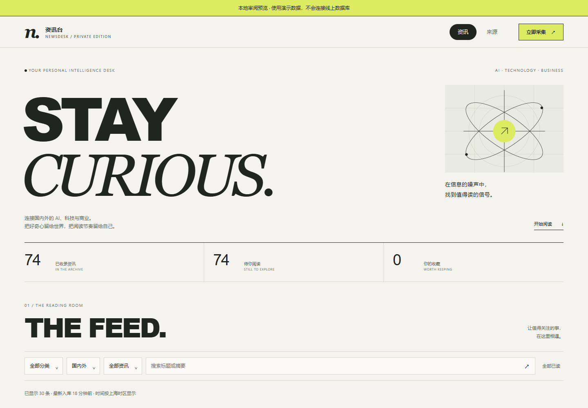

# 资讯台 · Newsdesk

自己的 AI、科技与商业资讯收件箱。用一个 Cloudflare Worker 提供阅读界面、API 与定时采集，D1 保存新闻和阅读状态。

[项目介绍](https://jjh-python667.github.io/projects/newsdesk.html) · [作者的个人作品集](https://jjh-python667.github.io/) · [私人实例入口](https://newsdesk.gongjiang667.workers.dev/)

私人实例通过 Cloudflare Access 限制为本人使用。公开仓库和下面的截图用于展示实现；没有面向访客开放的在线阅读账户。

截图来自本地审阅预览，74 条是固定演示数据，不是线上新闻数量。

## 能做什么

- 聚合国内外 AI、科技与商业 RSS / Atom，附带 25 个来源的初始化清单。
- 分类、地区、关键词和未读 / 收藏筛选；分页浏览与原文跳转。
- 收藏、已读状态保存在 D1，查看原文时异步标记已读。
- 每 30 分钟定时采集，支持手动采集、有限重试、来源错误隔离与诊断。
- Cloudflare Access JWT 验签、精确邮箱名单以及内部服务绑定采集。
- 标题遮罩开场、模块进场、卡片 stagger 与插画轻微视差；手机、深色及减少动态效果适配。

## 状态与验证

2026-11-09 的个人部署回报为 25 个来源中 24 个成功；36氪返回人机验证页，保留历史资讯并继续按轮次尝试。来源站点的可用性会变化。

仓库包含审阅通过的新版前端。该前端已完成 24 项本地回归检查，另有来源页首加载定位与快速切换定向检查。接口使用本地模拟，真实线上版本是否已切换、Access 与 D1 的发布后表现需按实际部署验收。

HTML 离线 gzip 约 14KB。没有生产 npm 依赖、外部动画库、字体、视频或 WebGL；动效使用 Web Animations API 与 IntersectionObserver。性能样本和范围见 [前端审阅报告](review/REVIEW.md)。

项目开发、前端改造与验证由 AI 编程助手辅助完成。翻译标题和中文摘要目前仅预留字段，没有默认调用模型。

## 本地看界面

需要 Node.js 20 或更新版本，无需 npm install：

    git clone https://github.com/jjh-python667/newsdesk.git
    cd newsdesk
    npm run check
    npm run preview

打开 http://127.0.0.1:4173/ 。页面顶部标注“本地审阅预览”，所有操作只使用内存演示数据，不连接线上 D1。原文演示地址使用 example.com。结束时在终端按 Ctrl+C。

## 修改前端

    npm run build
    npm run check

编辑 src/ui.html，再生成 src/ui.js；Worker 导入的是 ui.js。

## 部署到自己的 Cloudflare

先看 [部署与维护说明](HANDOFF.md)。配置模板为 wrangler.example.jsonc，实际账号配置和密钥由部署者自行设置，不在仓库中。

## 目录

- src/worker.js：采集、解析、Access 校验与 API。
- src/ui.html / src/ui.js：前端源文件与生成模块。
- scripts/build-ui.cjs：构建与一致性检查。
- schema.sql / sources.sql：新数据库结构与来源清单。
- review/：仅演示数据的预览、截图和本地验证报告。
- .cursor/rules/：动效与性能维护偏好。

来源文本、图片等内容的使用范围以各来源授权和条款为准；此仓库不分发抓取到的文章数据库。
